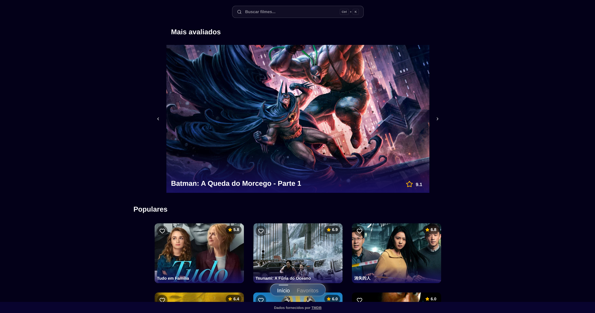
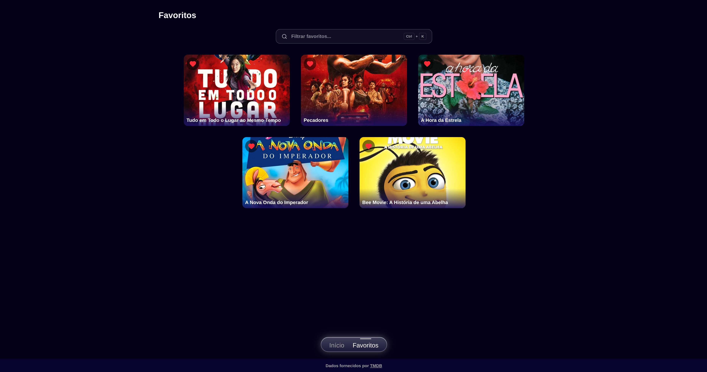

# Catálogo de Filmes Interativo

Aplicação web em React + TypeScript para explorar filmes usando a API do [TMDB](https://www.themoviedb.org/): descubra títulos populares, busque por nome, veja detalhes e monte sua lista de favoritos.

## Screenshots

> Adicione aqui os prints do app (salve em `docs/screenshots/`):
>
> 
> 
> 

## O que o usuário pode fazer

- **Explorar** o carrossel de filmes mais bem avaliados e uma lista de filmes populares (a página é sorteada a cada visita, então sempre aparece algo novo).
- **Buscar filmes por nome**, com mensagem de validação para busca vazia e atalho `Ctrl + K` (ou `Cmd + K`) para focar no campo.
- **Ver detalhes** de um filme: sinopse, gêneros, duração, nota e imagem de fundo.
- **Favoritar e desfavoritar** filmes com o botão de coração em qualquer card.
- **Gerenciar favoritos** em uma página própria, com filtro por título. Os favoritos ficam salvos no navegador (`localStorage`) e continuam lá ao recarregar a página.
- Receber feedback de **carregando, erro e nenhum resultado**, e uma página 404 para rotas inexistentes.

## Tecnologias

React 19, TypeScript, Vite, React Router, Tailwind CSS, shadcn/ui, Embla Carousel, Vitest e Testing Library.

## Como rodar o projeto

Pré-requisitos: Node.js (LTS) e npm.

1. Clone o repositório e entre na pasta:

```bash
git clone https://github.com/Aranhadaniela/catalogo-de-filmes-interativo.git
cd catalogo-de-filmes-interativo
```

2. Instale as dependências:

```bash
npm install
```

3. Configure a API do TMDB. Crie uma conta gratuita no TMDB, gere um **token de leitura da API** e copie o exemplo de variáveis de ambiente:

```bash
cp .env.example .env
```

Depois cole o token em `VITE_TMDB_TOKEN` dentro do `.env`.

4. Rode em modo desenvolvimento e abra o endereço exibido no terminal (normalmente `http://localhost:5173`):

```bash
npm run dev
```

## Testes

```bash
npm test               # roda a suíte uma vez
npm run test:watch     # modo interativo
```

A suíte cobre:

- contexto de favoritos (adicionar, remover, persistência e `localStorage` corrompido);
- serviço do TMDB (URLs, limite de resultados e tratamento de erro);
- componente de busca (validação, envio e atalho `Ctrl + K`);
- página de favoritos (estado vazio e filtro por título).

## Scripts disponíveis

- `npm run dev`: inicia o servidor de desenvolvimento
- `npm run build`: gera a build de produção
- `npm run preview`: executa a versão de produção localmente
- `npm run lint`: executa o lint do projeto
- `npm test`: executa os testes

## Melhorias futuras

- Configurar CI (GitHub Actions) para rodar lint, testes e build a cada push/PR.
- Paginação ou scroll infinito nas listas e nos resultados de busca.
- Filtros por gênero, ano e nota.
- Testes end-to-end (Playwright) cobrindo os fluxos principais.
- Sincronizar favoritos com uma conta de usuário/backend.
- Página de Configurações (tema claro/escuro, idioma).
- Mover a chamada ao TMDB para um proxy/backend, para não expor o token no bundle do front-end.
- Deploy automático (Vercel/Netlify) com preview por PR.
